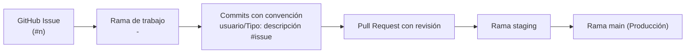
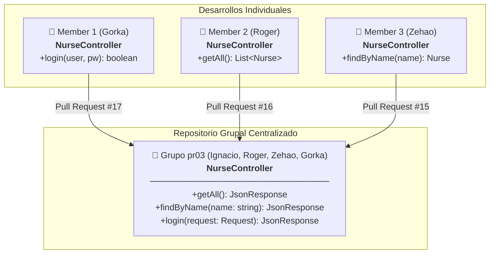
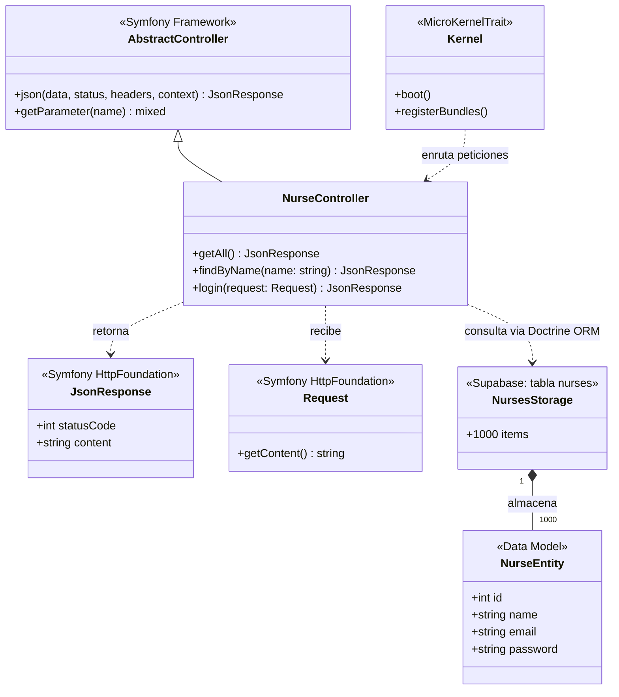
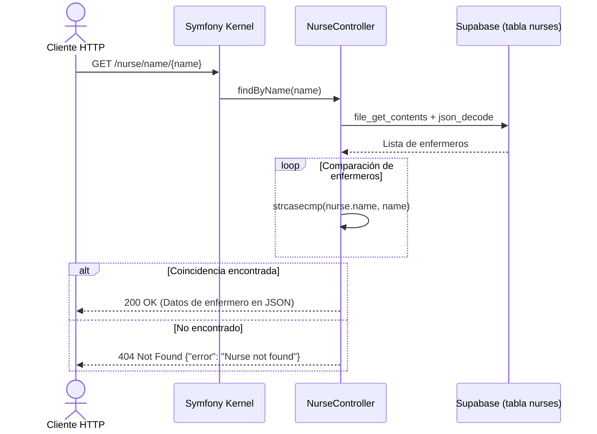
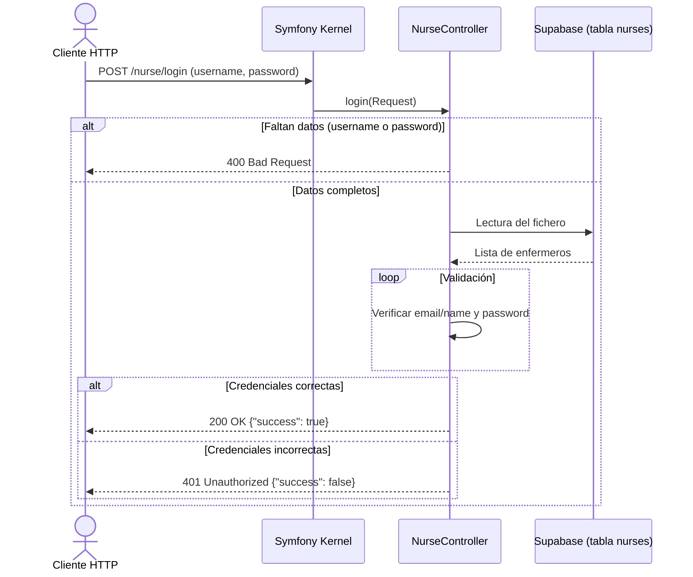
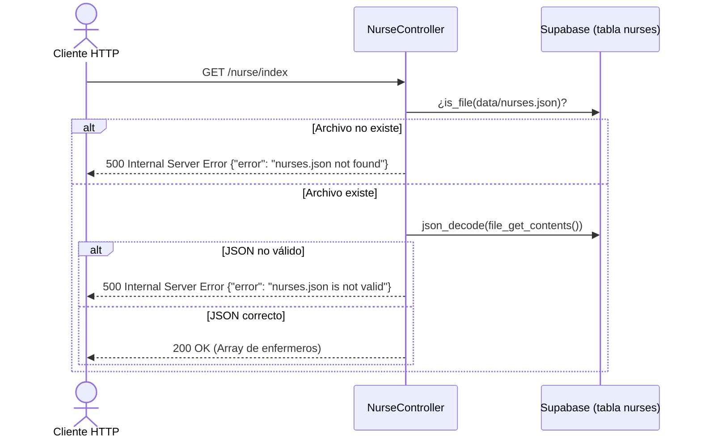
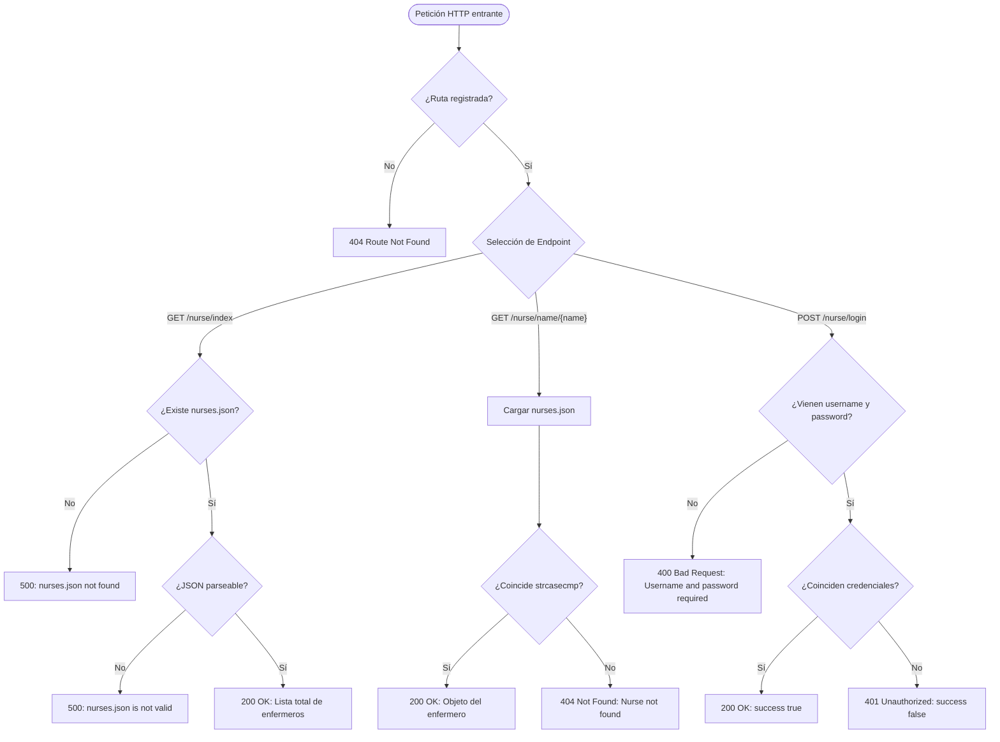

# Nurse Simulator — Documentación General del Proyecto

> **M0616 - Proyecto Intermodular | DAW 2 (Curso 2026/2027)**  
> **Centro:** STUCOM Pelai (Barcelona)  
> **Grupo:** pr03  
> **Autores:** Ignacio Breñas Muñoz, Christopher Roger Tito Farez, Zehao Yin, Gorka Ramirez  
> **Repositorio:** [https://github.com/Ignaciobrenas/Nurse-Simulator](https://github.com/Ignaciobrenas/Nurse-Simulator)

---

## 1. Resumen Ejecutivo y Equipo

**Nurse Simulator** es una API REST desarrollada con **Symfony 7.4** y **PHP 8.2+** cuyo objetivo es simular la gestión del personal de enfermería de un centro hospitalario. 

El proyecto está planteado como un trabajo académico en equipo, concebido para evolucionar incrementalmente a lo largo de diversas fases de desarrollo. En esta primera fase, la API expone servicios web esenciales para la consulta, filtrado e inicio de sesión de enfermeros/as, operando con un sistema de almacenamiento desacoplado de bases de datos relacionales tradicionales.

### Equipo de Desarrollo y Roles

| Miembro | Rol | Responsabilidades |
|---|---|---|
| **Ignacio Breñas Muñoz** | **Project Manager & Tech Lead** | Organización global del equipo, creación de ramas individuales, reparto de issues en GitHub Projects, revisión de Pull Requests y aseguramiento de la estabilidad del proyecto. |
| **Christopher Roger Tito Farez** | **Backend Developer** | Implementación del endpoint `GET /nurse/index` y capturas de prueba. |
| **Zehao Yin** | **Backend Developer** | Implementación del endpoint `GET /nurse/name/{name}` y dataset de 1.000 enfermeros. |
| **Gorka Ramirez** | **Backend Developer** | Implementación del endpoint `POST /nurse/login` y verificación de credenciales. |

---

## 2. Arquitectura de Datos y Almacenamiento

En la fase actual, la aplicación no hace uso de una base de datos relacional (como MySQL o PostgreSQL), sino que persiste y consulta la información a partir de un archivo estructurado en formato JSON:

* **Ruta del archivo:** [`data/nurses.json`](file:///C:/Users/Ignacio/Desktop/Nurse-Simulator/data/nurses.json)
* **Volumen:** Contiene 1.000 registros de prueba generados para evaluar el rendimiento y comportamiento de la API con volúmenes realistas.

### Estructura de la Entidad Nurse

Cada fila en la tabla `nurses` de Supabase cuenta con la siguiente estructura:

| Campo | Tipo de dato | Descripción |
|---|---|---|
| `id` | `int` | Identificador único del enfermero/a |
| `name` | `string` | Nombre del enfermero/a |
| `email` | `string` | Dirección de correo electrónico |
| `password` | `string` | Clave de acceso |

> [!WARNING]
> Las contraseñas se almacenan actualmente en **texto plano** exclusivamente con fines educativos y de prueba local. En fases posteriores se implementará hashing criptográfico (`PasswordHasherInterface`) y autenticación basada en tokens o sesiones seguras.

---

## 3. Metodología de Trabajo y Flujo Git

El equipo adopta una metodología ágil apoyada en las herramientas de **GitHub**:



### Principios del Flujo de Trabajo:
1. **GitHub Projects:** Las tareas se organizan en un tablero Kanban con tres estados: `Todo`, `In progress` y `Done`.
2. **Issues y Ramas:** Toda tarea tiene asignado un *Issue*. Para desarrollarla, se crea una rama específica siguiendo la nomenclatura:  
   `<nº_issue>-<descripción>`  
   *(Ejemplo: `2-implement-read-all-nurses-from-file`)*.
3. **Convención de Commits:**  
   `usuario/Tipo: descripción #issue`  
   *(Ejemplo: `roger/Feat: implement read all nurses from file #2`)*.
4. **Pull Requests y Despliegue:** Todo cambio requiere una *Pull Request* revisada por el equipo antes de integrarse en la rama `staging` y posteriormente en `main`.

---

## 4. Trabajo Realizado y Fases de Desarrollo

### 4.1. Configuración del Framework Base (Setup Basic Framework)
* Creación de la estructura base del proyecto con **Symfony 7.4**.
* Configuración de dependencias vía [`composer.json`](file:///C:/Users/Ignacio/Desktop/Nurse-Simulator/composer.json), ciclo de vida con [`src/Kernel.php`](file:///C:/Users/Ignacio/Desktop/Nurse-Simulator/src/Kernel.php) y enrutamiento en [`config/routes.yaml`](file:///C:/Users/Ignacio/Desktop/Nurse-Simulator/config/routes.yaml).
* Inclusión de plantilla de variables de entorno [`.env.example`](file:///C:/Users/Ignacio/Desktop/Nurse-Simulator/.env.example) para evitar filtración de secretos y facilitar la replicación del entorno.

### 4.2. Listar Todos los Enfermeros (Read all nurses from file)
* **Rama:** `2-implement-read-all-nurses-from-file`
* **Implementación:** Endpoint `GET /nurse/index` dentro de [`NurseController`](file:///C:/Users/Ignacio/Desktop/Nurse-Simulator/src/Controller/NurseController.php).
* **Lógica:**
  1. Comprueba la existencia física de [`data/nurses.json`](file:///C:/Users/Ignacio/Desktop/Nurse-Simulator/data/nurses.json). Si no existe, devuelve HTTP 500 (`nurses.json not found`).
  2. Lee y parsea el archivo JSON. Si el contenido no es un JSON válido, responde con HTTP 500 (`nurses.json is not valid`).
  3. Si la lectura es exitosa, retorna el listado completo con HTTP 200 en formato JSON.

### 4.3. Inicio de Sesión de Enfermero (Nurse login from file)
* **Rama:** `3-implement-nurse-login-from-file`
* **Implementación:** Endpoint `POST /nurse/login` dentro de [`NurseController`](file:///C:/Users/Ignacio/Desktop/Nurse-Simulator/src/Controller/NurseController.php).
* **Lógica:**
  1. Recibe en el cuerpo de la petición un objeto JSON con `username` y `password`.
  2. Valida la presencia de ambos parámetros. Si falta alguno, retorna HTTP 400 (`Username and password are required`).
  3. Compara las credenciales contra los registros del archivo:
     * El campo `username` puede coincidir tanto con el **correo electrónico (`email`)** como con el **nombre (`name`)**, realizando una comparación insensible a mayúsculas y minúsculas (`strcasecmp`).
  4. Si coincide la contraseña, retorna HTTP 200 con `{"success": true}`.
  5. En caso contrario, retorna HTTP 401 Unauthorized con `{"success": false}`.

### 4.4. Búsqueda de Enfermero por Nombre (Find nurse by name from file)
* **Rama:** `4-implement-find-nurse-by-name-from-file`
* **Implementación:** Endpoint `GET /nurse/name/{name}` dentro de [`NurseController`](file:///C:/Users/Ignacio/Desktop/Nurse-Simulator/src/Controller/NurseController.php).
* **Lógica:**
  1. Recibe el parámetro `{name}` en la ruta URL.
  2. Realiza un recorrido sobre el archivo JSON comprobando nombres sin distinguir mayúsculas ni minúsculas (`strcasecmp`).
  3. Si lo encuentra, devuelve el objeto completo del enfermero con HTTP 200.
  4. Si no se localiza ningún registro con ese nombre, retorna HTTP 404 con `{"error": "Nurse not found"}`.
  5. En esta misma fase se amplió el dataset de prueba a 1.000 enfermeros.

### 4.5. Búsqueda de Enfermero por ID (Read nurse by ID)
* **Rama:** `55-implement-read-nurse-by-id-endpoint-get-nurseid`
* **Implementación:** Endpoint `GET /nurse/{id}` en `NurseController::getById`, usando `NurseRepository::find()`.
* **Lógica:**
  1. Valida que `{id}` sea un entero positivo (`filter_var` con `min_range: 1`); si no, HTTP 400.
  2. Consulta el registro con `NurseRepository::find($id)`; si no existe, HTTP 404.
  3. Devuelve el enfermero con HTTP 200 **excluyendo el campo `password`**.
  4. Las excepciones de Doctrine (DBAL/ORM) se capturan y devuelven HTTP 500 en JSON.
* **Decisiones técnicas:**
  * La ruta no lleva `requirements: ['id' => '\d+']`: con esa restricción `/nurse/abc` daría 404 del router y no el 400 requerido.
  * Se fijó `server_version` en `config/packages/doctrine.yaml` para que Doctrine no se conecte a la BD al construir el repositorio; así un fallo de conexión se captura dentro del controlador.
* **Pruebas:** PHPUnit en `tests/Controller/NurseControllerGetByIdTest.php` (200, 400, 404, 500). Capturas en `docs/postman/readById/`.

### 4.6. CI de Calidad de Código (Workflow `3-code-quality.yml`)
* **Rama:** `60-setup-github-actions-ci-code-quality`
* **Implementación:** Workflow de GitHub Actions en `.github/workflows/3-code-quality.yml`, con PHP-CS-Fixer (`.php-cs-fixer.dist.php`, ruleset `@PSR12`) como dependencia de desarrollo.
* **Disparadores:** `push` y `pull_request` hacia `staging` y `main`.
* **Pasos del job** (`ubuntu-latest`, PHP 8.2):
  1. `composer install` (con caché de `vendor`) y copia de `.env.example` a `.env`, ya que `.env` está ignorado por git.
  2. Sintaxis PHP: `php -l` sobre todos los `.php` de `src`, `tests` y `config`.
  3. `php bin/console lint:yaml config/`.
  4. `php bin/console lint:container`, con un `DATABASE_URL` ficticio (no abre conexión).
  5. Estilo PSR-12: `php-cs-fixer fix --dry-run --diff`, que falla si hay diferencias.
* **Decisiones técnicas:**
  * Se añadió `.gitattributes` (`eol=lf`) para que en Windows `autocrlf` no provoque falsos positivos de `line_ending`.
  * Al incorporar `tests/` el chequeo detectó una violación real de PSR-12 (`new class (`), corregida en un commit `Style:`.
* **Simulación de fallo:** PR de prueba #66 (cerrada sin mergear) con un `;` ausente en `src/Ci/CiFailureExample.php`. El workflow se detiene en rojo en el paso `PHP syntax check (php -l)`.
* **Evidencias:** `docs/ci/codeQuality/` (`codeQualityGreen.png`, `codeQualityRedPR.png`, `codeQualityRed.png`).

---

## 5. Especificación de Endpoints de la API

### Tabla Resumen

| Método | Endpoint | Parámetros | Respuestas esperadas |
|---|---|---|---|
| `GET` | `/nurse/index` | Ninguno | `200 OK`: Lista completa de enfermeros<br>`500 Internal Server Error`: Archivo ausente o JSON corrupto |
| `GET` | `/nurse/name/{name}` | Path param: `name` (string) | `200 OK`: Objeto del enfermero<br>`404 Not Found`: `{ "error": "Nurse not found" }` |
| `GET` | `/nurse/{id}` | Path param: `id` (entero > 0) | `200 OK`: Enfermero sin `password`<br>`400 Bad Request`: `id` no válido<br>`404 Not Found`: `{ "error": "Nurse not found" }`<br>`500 Internal Server Error`: Fallo de BD |
| `POST` | `/nurse/login` | JSON Body: `username`, `password` | `200 OK`: `{ "success": true }`<br>`400 Bad Request`: Parámetros obligatorios faltantes<br>`401 Unauthorized`: `{ "success": false }` |

### Ejemplos de Petición y Respuesta

#### 1. Listar todos los enfermeros
```bash
curl -X GET http://localhost:8000/nurse/index
```
**Respuesta (HTTP 200):**
```json
[
  {
    "id": 1,
    "name": "Ana",
    "email": "ana@hospital.com",
    "password": "ana123"
  },
  {
    "id": 2,
    "name": "Carlos",
    "email": "carlos@hospital.com",
    "password": "carlos123"
  }
]
```

#### 2. Buscar por nombre
```bash
curl -X GET http://localhost:8000/nurse/name/Ana
```
**Respuesta (HTTP 200):**
```json
{
  "id": 1,
  "name": "Ana",
  "email": "ana@hospital.com",
  "password": "ana123"
}
```
**Error (HTTP 404):**
```json
{
  "error": "Nurse not found"
}
```

#### 2b. Buscar por ID
```bash
curl -X GET http://localhost:8000/nurse/1000
```
**Respuesta (HTTP 200):**
```json
{
  "id": 1000,
  "name": "Andrea Alvarez",
  "email": "andrea.alvarez@hospital.com"
}
```
**Errores:** `/nurse/1a` → HTTP 400 `{"error": "Invalid id: must be a positive integer"}`; `/nurse/99999` → HTTP 404 `{"error": "Nurse not found"}`.

#### 3. Inicio de sesión
```bash
curl -X POST http://localhost:8000/nurse/login \
  -H "Content-Type: application/json" \
  -d '{"username": "ana@hospital.com", "password": "ana123"}'
```
**Respuesta exitosa (HTTP 200):**
```json
{
  "success": true
}
```
**Credenciales incorrectas (HTTP 401):**
```json
{
  "success": false
}
```
**Campos faltantes (HTTP 400):**
```json
{
  "success": false,
  "message": "Username and password are required"
}
```

---

## 6. Esquemas de Arquitectura, UML y Diagramas de Flujo

### 6.1. Esquema de Integración Modular (Desarrollo Individual a Repositorio Grupal)

Basado en las directrices de la práctica intermodular (`pr03_Introduccio_back_end`), cada desarrollador implementó su método de forma individual antes de la integración coordinada en el repositorio grupal:



### 6.2. Diagrama de Clases UML

Representación de las clases y relaciones de la arquitectura de la aplicación en Symfony 7.4:



### 6.3. Diagrama de Secuencia: Búsqueda por Nombre



### 6.4. Diagrama de Secuencia: Login de Enfermero



### 6.5. Diagrama de Secuencia: Listar Todos



### 6.6. Diagrama de Flujo Lógico de la Aplicación



---

## 7. Pruebas y Colección Postman

El proyecto cuenta con una colección completa de **Postman** ubicada en:
* [`docs/postman/nurse-api.postman_collection.json`](file:///C:/Users/Ignacio/Desktop/Nurse-Simulator/docs/postman/nurse-api.postman_collection.json)

Dicha colección contiene carpetas organizadas con capturas de prueba para cada funcionalidad:
* [`docs/postman/readAll`](file:///C:/Users/Ignacio/Desktop/Nurse-Simulator/docs/postman/readAll): Pruebas del endpoint `/nurse/index`.
* [`docs/postman/readByName`](file:///C:/Users/Ignacio/Desktop/Nurse-Simulator/docs/postman/readByName): Pruebas del endpoint `/nurse/name/{name}` con respuestas 200 y 404.
* [`docs/postman/login`](file:///C:/Users/Ignacio/Desktop/Nurse-Simulator/docs/postman/login): Pruebas del endpoint `/nurse/login` con respuestas 200, 400 y 401.

---

## 8. Estructura del Repositorio

```
Nurse-Simulator/
├── bin/
│   └── console                     # Consola CLI de Symfony
├── config/                         # Configuraciones del framework y paquetes
│   ├── packages/
│   ├── routes.yaml
│   └── services.yaml
├── data/
│   └── nurses.json                 # Dataset simulado (1000 enfermeros)
├── docs/                           # Documentación del proyecto
│   ├── general/
│   │   ├── DOCUMENTACION_ES.md     # Documentación detallada en español
│   │   ├── DOCUMENTATION_EN.md     # Documentación detallada en inglés
│   │   ├── Nurse-Simulator.docx    # Documento de memoria de proyecto
│   │   └── Nurse-Simulator_...pdf  # Memoria académica oficial en PDF
│   └── postman/                    # Colección y evidencias de prueba
│       ├── login/
│       ├── readAll/
│       ├── readByName/
│       └── nurse-api.postman_collection.json
├── public/
│   └── index.php                   # Punto de entrada HTTP (Front Controller)
├── src/
│   ├── Controller/
│   │   └── NurseController.php     # Controlador con las rutas de enfermeros
│   └── Kernel.php                  # Núcleo de la aplicación Symfony
├── .env.example                    # Plantilla de variables de entorno
├── composer.json                   # Definición de dependencias PHP y scripts
├── README.md                       # Lectura rápida del repositorio
└── LICENSE                         # Licencia del proyecto
```

---

## 9. Instalación y Guía de Uso Local

### Prerrequisitos
* **PHP** >= 8.2 (con extensiones `mbstring`, `json`, `ctype`, `pdo_pgsql`, etc.)
* **Composer** >= 2.0
* **Cuenta y proyecto en [Supabase](https://supabase.com/)** con la tabla 
urses configurada
* *(Opcional)* **Symfony CLI**

### Pasos de Instalación

1. **Clonar el repositorio:**
   ```bash
   git clone https://github.com/Ignaciobrenas/Nurse-Simulator.git
   cd Nurse-Simulator
   ```

2. **Instalar dependencias de PHP:**
   ```bash
   composer install
   ```

3. **Configurar el entorno:**
   ```bash
   cp .env.example .env
   ```

4. **Iniciar el servidor local:**
   * Utilizando Symfony CLI:
     ```bash
     symfony server:start
     ```
   * O con el servidor embebido de PHP:
     ```bash
     php -S localhost:8000 -t public
     ```

5. **Verificar rutas disponibles:**
   ```bash
   php bin/console debug:router
   ```

---

## 10. Hoja de Ruta (Roadmap) y Próximos Pasos

Para las siguientes fases del proyecto intermodular, están previstas las siguientes mejoras arquitectónicas:

1. **Capa de Abstracción y Persistencia:** Extraer la lógica de manipulación del archivo JSON a un servicio o repositorio (`NurseRepository`), evitando duplicar la lectura de ficheros en el controlador.
2. **Entidades y DTOs:** Definir modelos de datos con tipado estricto y validaciones de datos (Symfony Validator).
3. **Seguridad y Criptografía:** Implementar hashing seguro de contraseñas mediante `PasswordHasherInterface` y tokens de autenticación (JWT o sesiones).
4. **Base de Datos Relacional:** Migración del almacenamiento de JSON a una base de datos mediante **Doctrine ORM** (MySQL / PostgreSQL / SQLite) y migraciones.
5. **Testing Automatizado:** Cobertura de pruebas unitarias y de integración mediante PHPUnit y WebTestCase de Symfony.
