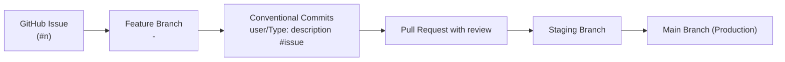
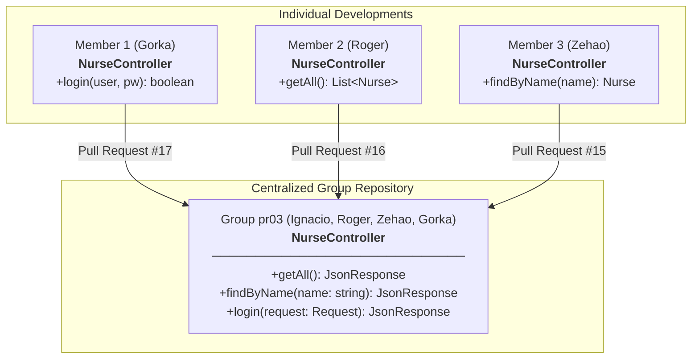
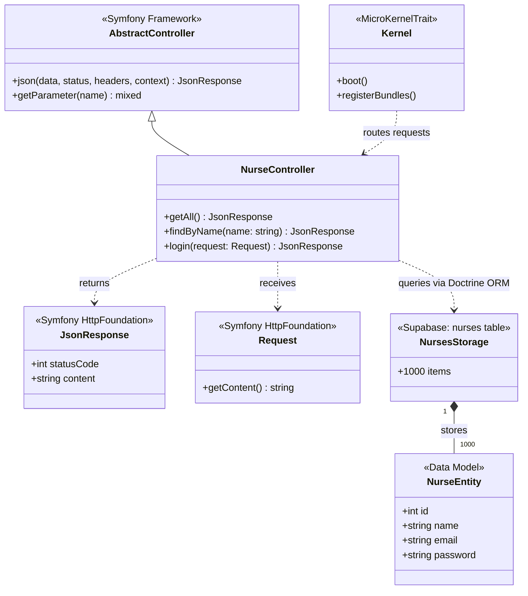
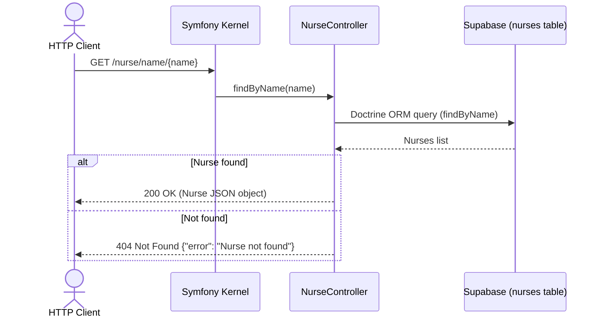
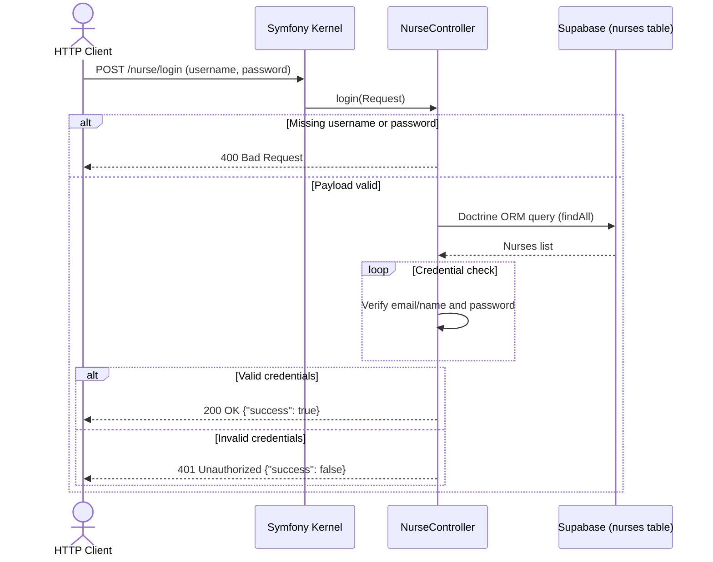
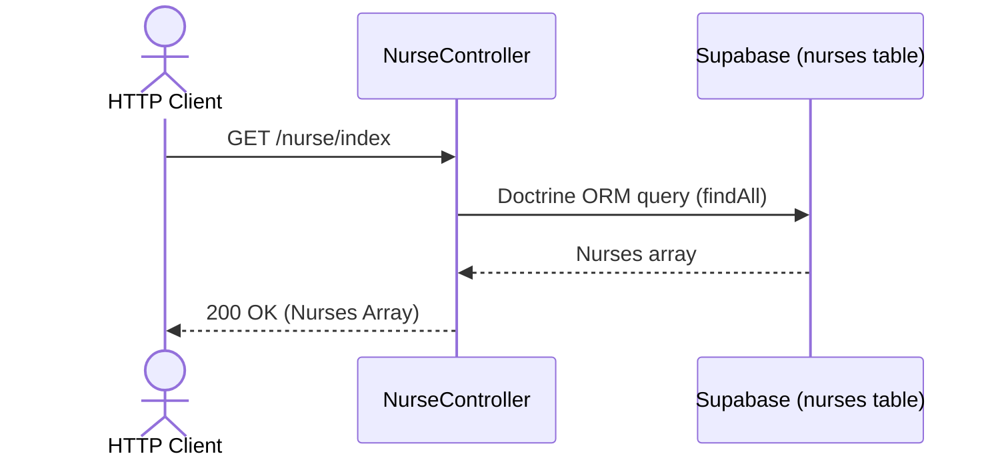
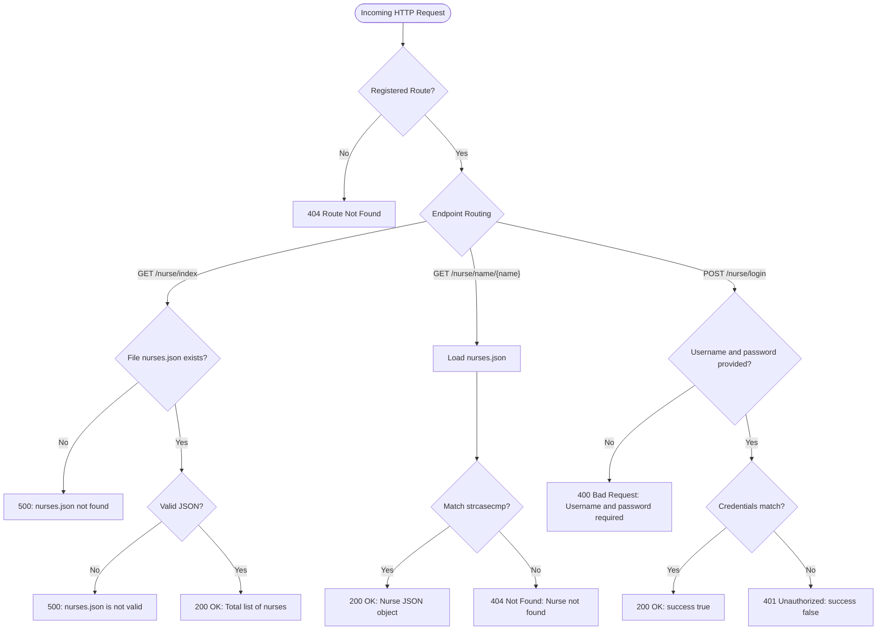

# Nurse Simulator — Comprehensive Project Documentation

> **M0616 - Intermodular Project | DAW 2 (Academic Year 2026/2027)**  
> **Institution:** STUCOM Pelai (Barcelona)  
> **Team:** Group pr03  
> **Authors:** Ignacio Breñas Muñoz, Christopher Roger Tito Farez, Zehao Yin, Gorka Ramirez  
> **Repository:** [https://github.com/Ignaciobrenas/Nurse-Simulator](https://github.com/Ignaciobrenas/Nurse-Simulator)

---

## 1. Executive Summary & Team Roles

**Nurse Simulator** is a RESTful API built with **Symfony 7.4** and **PHP 8.2+** designed to simulate the management of hospital nursing staff.

The project is structured as an academic team endeavor conceived to evolve incrementally across progressive development phases. In this initial phase, the API exposes essential web services for querying, searching, and authenticating nurses, utilizing a file-based storage architecture decoupled from traditional relational database systems.

### Development Team & Roles

| Member | Role | Responsibilities |
|---|---|---|
| **Ignacio Breñas Muñoz** | **Project Manager & Tech Lead** | Overall team organization, feature branch creation for each developer, issue breakdown and assignment in GitHub Projects, Pull Request reviews, and project quality assurance. |
| **Christopher Roger Tito Farez** | **Backend Developer** | Implementation of `GET /nurse/index` endpoint and Postman run evidence. |
| **Zehao Yin** | **Backend Developer** | Implementation of `GET /nurse/name/{name}` endpoint and 1,000 nurses mock dataset expansion. |
| **Gorka Ramirez** | **Backend Developer** | Implementation of `POST /nurse/login` credential validation and Postman test evidence. |

---

## 2. Data Architecture & Storage

In the current development phase, the application does not rely on a relational database (such as MySQL or PostgreSQL). Instead, all data is read and parsed from a structured JSON file:

* **File Location:** [`data/nurses.json`](file:///C:/Users/Ignacio/Desktop/Nurse-Simulator/data/nurses.json)
* **Dataset Volume:** Contains 1,000 mock records generated to evaluate the API's behavior and performance under realistic load conditions.

### Nurse Entity Schema

Each row in the `nurses` table on Supabase contains the following fields:

| Field | Data Type | Description |
|---|---|---|
| `id` | `int` | Unique identifier for the nurse |
| `name` | `string` | Full name of the nurse |
| `email` | `string` | Contact email address |
| `password` | `string` | Access credential |

> [!WARNING]
> Passwords are currently stored in **plain text** solely for educational and local prototyping purposes. Future phases will introduce cryptographic hashing via `PasswordHasherInterface` and secure token/session-based authentication.

---

## 3. Methodology & Git Workflow

The team adopts an agile development methodology supported by **GitHub** collaboration tools:



### Core Workflow Guidelines:
1. **GitHub Projects:** Tasks are tracked on a Kanban board across three columns: `Todo`, `In progress`, and `Done`.
2. **Issues & Branching:** Every feature or bugfix is linked to an *Issue*. Developers create a dedicated branch formatted as:  
   `<issue_number>-<description>`  
   *(Example: `2-implement-read-all-nurses-from-file`)*.
3. **Commit Convention:**  
   `user/Type: description #issue`  
   *(Example: `roger/Feat: implement read all nurses from file #2`)*.
4. **Pull Requests & Code Review:** All branches must go through a peer-reviewed *Pull Request* targeting `staging` before final integration into `main`.

---

## 4. Completed Work & Development Phases

### 4.1. Basic Framework Setup
* Initialized the core project structure on **Symfony 7.4**.
* Configured Composer dependencies via [`composer.json`](file:///C:/Users/Ignacio/Desktop/Nurse-Simulator/composer.json), application lifecycle in [`src/Kernel.php`](file:///C:/Users/Ignacio/Desktop/Nurse-Simulator/src/Kernel.php), and routes in [`config/routes.yaml`](file:///C:/Users/Ignacio/Desktop/Nurse-Simulator/config/routes.yaml).
* Provided a [`.env.example`](file:///C:/Users/Ignacio/Desktop/Nurse-Simulator/.env.example) environment template to protect secrets and facilitate local environment setup.

### 4.2. Read All Nurses From File
* **Branch:** `2-implement-read-all-nurses-from-file`
* **Implementation:** `GET /nurse/index` endpoint inside [`NurseController`](file:///C:/Users/Ignacio/Desktop/Nurse-Simulator/src/Controller/NurseController.php).
* **Logic:**
  1. Verifies the physical existence of [`data/nurses.json`](file:///C:/Users/Ignacio/Desktop/Nurse-Simulator/data/nurses.json). If missing, returns HTTP 500 (`nurses.json not found`).
  2. Reads and parses JSON contents. If invalid or corrupt, returns HTTP 500 (`nurses.json is not valid`).
  3. Returns the complete array of nurse records with HTTP 200 JSON response upon success.

### 4.3. Implement Nurse Login From File
* **Branch:** `3-implement-nurse-login-from-file`
* **Implementation:** `POST /nurse/login` endpoint inside [`NurseController`](file:///C:/Users/Ignacio/Desktop/Nurse-Simulator/src/Controller/NurseController.php).
* **Logic:**
  1. Accepts a JSON request body containing `username` and `password`.
  2. Validates that both fields are supplied. If either is missing, responds with HTTP 400 (`Username and password are required`).
  3. Compares credentials against records in [`data/nurses.json`](file:///C:/Users/Ignacio/Desktop/Nurse-Simulator/data/nurses.json):
     * The `username` field flexibly matches either the **`email`** or the **`name`** field using case-insensitive comparison (`strcasecmp`).
  4. Returns HTTP 200 with `{"success": true}` on matching credentials.
  5. Returns HTTP 401 Unauthorized with `{"success": false}` if credentials do not match.

### 4.4. Find Nurse By Name From File
* **Branch:** `4-implement-find-nurse-by-name-from-file`
* **Implementation:** `GET /nurse/name/{name}` endpoint inside [`NurseController`](file:///C:/Users/Ignacio/Desktop/Nurse-Simulator/src/Controller/NurseController.php).
* **Logic:**
  1. Extracts `{name}` from the route parameters.
  2. Queries the `nurses` table on Supabase via Doctrine ORM, filtering by name (case-insensitive).
  3. Returns HTTP 200 with the matching nurse object if found.
  4. Returns HTTP 404 with `{"error": "Nurse not found"}` if no matching record exists.
  5. Mock data was migrated from the JSON file into the Supabase database.

### 4.5. Read Nurse By ID
* **Branch:** `55-implement-read-nurse-by-id-endpoint-get-nurseid`
* **Implementation:** `GET /nurse/{id}` endpoint in `NurseController::getById`, using `NurseRepository::find()`.
* **Logic:**
  1. Validates that `{id}` is a positive integer (`filter_var` with `min_range: 1`); otherwise HTTP 400.
  2. Looks the record up with `NurseRepository::find($id)`; if missing, HTTP 404.
  3. Returns the nurse with HTTP 200 **excluding the `password` field**.
  4. Doctrine (DBAL/ORM) exceptions are caught and returned as a JSON HTTP 500.
* **Technical decisions:**
  * The route has no `requirements: ['id' => '\d+']`: with it, `/nurse/abc` would yield a router 404 instead of the required 400.
  * `server_version` was set in `config/packages/doctrine.yaml` so Doctrine does not connect to the DB when building the repository; a connection failure is thus caught inside the controller.
* **Tests:** PHPUnit in `tests/Controller/NurseControllerGetByIdTest.php` (200, 400, 404, 500). Screenshots in `docs/postman/readById/`.

### 4.6. Code Quality CI (Workflow `3-code-quality.yml`)
* **Branch:** `60-setup-github-actions-ci-code-quality`
* **Implementation:** GitHub Actions workflow at `.github/workflows/3-code-quality.yml`, with PHP-CS-Fixer (`.php-cs-fixer.dist.php`, `@PSR12` ruleset) as a dev dependency.
* **Triggers:** `push` and `pull_request` targeting `staging` and `main`.
* **Job steps** (`ubuntu-latest`, PHP 8.2):
  1. `composer install` (with `vendor` cache) and copy `.env.example` to `.env`, since `.env` is git-ignored.
  2. PHP syntax: `php -l` over every `.php` file in `src`, `tests` and `config`.
  3. `php bin/console lint:yaml config/`.
  4. `php bin/console lint:container`, using a dummy `DATABASE_URL` (no connection is opened).
  5. PSR-12 style: `php-cs-fixer fix --dry-run --diff`, which fails on any difference.
* **Technical decisions:**
  * A `.gitattributes` (`eol=lf`) was added so Windows `autocrlf` does not cause `line_ending` false positives.
  * Once `tests/` was covered, the check caught a real PSR-12 violation (`new class (`), fixed in a `Style:` commit.
* **Failure simulation:** test PR #66 (closed without merging) with a missing `;` in `src/Ci/CiFailureExample.php`. The workflow stops red at the `PHP syntax check (php -l)` step.
* **Evidence:** `docs/ci/codeQuality/` (`codeQualityGreen.png`, `codeQualityRedPR.png`, `codeQualityRed.png`).

### 4.7. Update Nurse
* **Branch:** `56-implement-update-nurse-endpoint-put-nurseid`
* **Implementation:** `PUT /nurse/{id}` endpoint in `NurseController::update`, using `NurseRepository::find()` and `EntityManagerInterface::flush()`.
* **Logic:**
  1. Validates that `{id}` is a positive integer (`filter_var` with `min_range: 1`); otherwise HTTP 400.
  2. Parses the body with `json_decode(..., JSON_THROW_ON_ERROR)`; if the JSON is malformed, empty or not an object with data, HTTP 400.
  3. Looks the nurse up with `NurseRepository::find($id)`; if missing, HTTP 404.
  4. Validates the fields: `name` and `email` are required (PUT replaces the resource), the email must be well formed and `password` is optional but, when sent, must be at least 8 characters with letters and numbers. Any failure returns HTTP 422.
  5. If the submitted data matches the stored data and no `password` is sent, returns HTTP 204 with no body and does not touch the DB.
  6. If the email belongs to another nurse, HTTP 409.
  7. Applies the changes (lowercased email, password hashed with `password_hash`), runs `flush()` and returns HTTP 200 with the nurse **excluding the `password` field**.
  8. Any Doctrine/DB failure during the lookup or the `flush()` returns a JSON HTTP 500.
* **Technical decisions:**
  * As in `GET /nurse/{id}`, the route has no `requirements: ['id' => '\d+']`: with it, `PUT /nurse/abc` would yield a router 405 instead of a 400.
  * The 409 is checked with `findOneBy(['email' => ...])` before `flush()`, and `UniqueConstraintViolationException` is also caught in case two requests arrive at the same time.
  * Same validation rules as `POST /nurse` so both endpoints stay consistent.
* **Tests:** PHPUnit in `tests/Controller/NurseControllerUpdateTest.php` (200, 204, 400, 404, 409, 422, 500). Screenshots in `docs/postman/update/`.

### 4.8. Security Audit & Dependencies CI (Workflow `4-security-audit.yml`)
* **Branch:** `61-setup-github-actions-ci-for-security-audit-dependencies`
* **Implementation:** GitHub Actions workflow at `.github/workflows/4-security-audit.yml`.
* **Triggers:** `push` and `pull_request` targeting `staging` and `main`.
* **Job steps** (`ubuntu-latest`, PHP 8.2):
  1. `composer validate --strict --no-check-publish`: checks that `composer.lock` is in sync with `composer.json`.
  2. `composer audit --locked`: looks for known vulnerabilities (CVEs / security advisories) in the versions pinned in `composer.lock`.
  3. Uses `git ls-files` to check that no `.env`, `.env.local` or `.env.*.local` file is tracked.
  4. Checks that every required variable used in `config/` (`%env(...)%`: `APP_SECRET`, `DATABASE_URL`, `DEFAULT_URI`) is declared in `.env.example`. Only variable names are printed, never their values.
* **Technical decisions:**
  * `--no-check-publish` is used because without it `--strict` fails (exit 2) on the missing `name` and `description` in `composer.json`, fields only required for publishable packages, not for a project.
  * With `--locked`, `composer audit` reads `composer.lock` directly, so the job needs neither `composer install` nor a cache.
  * The real `.env` does not exist in CI (it is git-ignored and holds secrets), so consistency is checked between the variables the configuration requires and those declared in `.env.example`. Variables with `default::` are skipped since they are optional.
  * The workflow marks the PR red but does not prevent merging: blocking it would require a GitHub branch protection rule that makes this check mandatory.
* **Failure simulation:** in PR #75, `symfony/yaml` was changed from `7.4.*` to `7.3.*` in `composer.json` without updating `composer.lock`. The workflow stops red at the `Validate composer.json / composer.lock (strict)` step (`"symfony/yaml" is in the lock file as "v7.4.20" but that does not satisfy your constraint "7.3.*"`). The change was then reverted and the workflow went back to green.
* **Evidence:** `docs/ci/securityAudit/` (`securityAuditGreen.png`, `securityAuditGreenSteps.png`, `securityAuditGreenPR.png`, `securityAuditRed.png`, `securityAuditRedSteps.png`, `securityAuditRedPR.png`).

### 4.9. API End-to-End Testing CI with Postman & Newman (Workflow `2-api-postman.yml`)
* **Branch:** `59-setup-github-actions-ci-for-postman-newman-e2e-tests`
* **Implementation:** GitHub Actions workflow at `.github/workflows/2-api-postman.yml` to execute End-to-End (E2E) integration tests for the REST API against a real PostgreSQL environment using Newman in headless mode.
* **Triggers:** `push` and `pull_request` targeting `staging` and `main`.
* **Job steps** (`ubuntu-latest`, PHP 8.2, Node.js 20, PostgreSQL 15):
  1. Service container `postgres:15` with automated healthcheck (`pg_isready`) on port 5432.
  2. `Setup PHP` with extensions `pdo`, `pdo_pgsql`, `mbstring`, `intl`, and `composer`.
  3. `Setup Node.js` (version 20) for the Newman CLI execution environment.
  4. Composer cache (`vendor/`).
  5. Environment configuration: copies `.env.example` to `.env` and generates `.env.local` configured with the runner's PostgreSQL service credentials.
  6. Dependency installation via `composer install --prefer-dist --no-progress --no-interaction`.
  7. Database migrations via `php bin/console doctrine:migrations:migrate --no-interaction` to provision the relational schema (`nurse`).
  8. Background Symfony development server startup via `php -S 127.0.0.1:8000 -t public > symfony_server.log 2>&1 &` with a 30-second timeout polling loop verifying HTTP response.
  9. Headless Postman collection execution:
     `npx newman run docs/postman/nurse-api.postman_collection.json --env-var "baseUrl=http://127.0.0.1:8000" --reporters cli,junit`.
  10. Server log dump (`symfony_server.log`) on failure.
  11. JUnit test report upload via `actions/upload-artifact@v4` as the `newman-report` artifact.
* **Technical decisions:**
  * A native PostgreSQL service is executed in the GitHub Actions runner to ensure authentic E2E tests against the real database engine without external dependencies or mocks.
  * To prevent shell escaping issues with special characters (such as `&charset=utf8`), database configuration is cleanly overridden using `.env.local`, Symfony Dotenv's native override mechanism.
  * The Postman collection covers the entire CRUD lifecycle: creation (`POST /nurse`), retrieval (`GET /nurse/index`), search by name (`GET /nurse/name/{name}`), lookup by ID (`GET /nurse/{id}`), valid and unauthorized authentication (`POST /nurse/login`), bad request and not found validations (400, 404), updates (`PUT /nurse/{id}`), and deletion followed by existence verification (`DELETE /nurse/{id}`).
* **Failure simulation:** Mandatory intentional failure verification in the pipeline (modifying a Postman collection assertion to expect an incorrect status code such as 200 instead of 201 Created), ensuring Newman halts the pipeline with exit code 1 and reports the failed assertion.
* **Evidence:** `docs/ci/apiPostman/` (`apiPostmanGreen.png`, `apiPostmanGreenSteps.png`, `apiPostmanGreenPR.png`, `apiPostmanRed.png`, `apiPostmanRedSteps.png`, `apiPostmanRedPR.png`).

### 4.10. CRUD PHPUnit Testing CI (Workflow `1-crud-phpunit.yml`)
* **Branch:** `58-setup-github-actions-ci-for-crud-phpunit-tests`
* **Implementation:** GitHub Actions workflow at `.github/workflows/1-crud-phpunit.yml` dedicated to automating the execution of the complete unit test suite (`tests/Controller/NurseControllerTest.php`) using PHPUnit.
* **Triggers:** `push` and `pull_request` targeting `staging` and `main` branches.
* **Job steps** (`ubuntu-latest`, PHP 8.2):
  1. `actions/checkout@v4` to pull repository code.
  2. `Setup PHP` via `shivammathur/setup-php@v2` (PHP 8.2, extensions `pdo`, `pdo_pgsql`, `mbstring`, `intl`, tool `composer`, with `coverage: none` for peak pipeline performance).
  3. Composer dependency caching (`actions/cache@v4` over the `vendor` directory keyed against `composer.lock`).
  4. Environment preparation: copies `.env.example` to `.env`.
  5. Dependency installation via `composer install --prefer-dist --no-progress --no-interaction`.
  6. PHPUnit test suite execution via `php bin/phpunit`.
* **Technical decisions:**
  * The CI environment specifies `APP_ENV: test`, a dedicated `APP_SECRET`, and a mocked `DATABASE_URL` that prevents unnecessary external socket connections, since controllers and repositories are isolated through test doubles (mocks).
  * The `vendor/` caching mechanism substantially reduces build latency, executing the comprehensive test suite in 14-18 seconds.
* **Failure simulation:** In simulation PR #76 (closed without merging) on branch `test/ci-failure-58-phpunit`, a dummy endpoint `GET /nurse/status` returning HTTP 503 was intentionally added alongside a test asserting HTTP 200. The workflow halted in red at the `Run PHPUnit tests` step with exit code 1 (`FAILURES! Tests: 60, Assertions: 140, Failures: 1. Failed asserting that 503 matches expected 200.`), whereas `3-code-quality.yml` succeeded in green, validating pipeline isolation and failure blocking capabilities against regressions.
* **Evidence:** `docs/ci/phpUnit/` (`phpUnitTestOkPR.png`, `phpUnitTestOkSummary.png`, `phpUnitTestOkSteps.png`, `phpUnitTestFailPR.png`, `phpUnitTestFailChecks.png`, `phpUnitTestFailSteps.png`).

### 4.11. Create Nurse
* **Branch:** `54-implement-create-nurse-endpoint-post-nurse`
* **Implementation:** Endpoint `POST /nurse` in `NurseController::create`, utilizing `NurseRepository` and `EntityManagerInterface::persist()` / `flush()`.
* **Logic:**
  1. Parses and decodes the JSON request body with `json_decode(..., JSON_THROW_ON_ERROR)`. If the JSON is malformed or empty, returns HTTP 400.
  2. Validates the mandatory presence of `name`, `email`, and `password`. If any field is missing or empty, returns HTTP 400 (`All fields (name, email, password) are required`).
  3. Validates email format (`filter_var` with `FILTER_VALIDATE_EMAIL`) and password complexity constraints (minimum 8 characters, containing at least one letter and one number). Fails with HTTP 422 Unprocessable Content on validation errors.
  4. Checks for duplicate email registration using `NurseRepository::findOneBy(['email' => ...])` or catches `UniqueConstraintViolationException`, returning HTTP 409 Conflict (`Email already registered`).
  5. Instantiates the `Nurse` entity, hashes the password via `password_hash($password, PASSWORD_BCRYPT)`, persists and flushes changes to the database.
  6. Returns HTTP 201 Created with the serialized nurse entity excluding the `password` field.
  7. Catches database exceptions (Doctrine DBAL/ORM) and returns a JSON HTTP 500 response.
* **Tests:** PHPUnit in `tests/Controller/NurseControllerTest.php` (201, 400, 409, 422, 500). Postman test evidence in `docs/postman/createNurse/`.

### 4.12. Delete Nurse
* **Branch:** `57-implement-delete-nurse-endpoint-delete-nurseid`
* **Implementation:** Endpoint `DELETE /nurse/{id}` in `NurseController::delete`, utilizing `NurseRepository::find()` and `EntityManagerInterface::remove()` / `flush()`.
* **Logic:**
  1. Validates that route parameter `{id}` is a positive integer (`filter_var` with `min_range: 1`); otherwise returns HTTP 400 (`Invalid id: must be a positive integer`).
  2. Queries the database using `NurseRepository::find($id)`; if the record is missing, returns HTTP 404 (`{"error": "Nurse not found"}`).
  3. Invokes `$entityManager->remove($nurse)` and `$entityManager->flush()`.
  4. Returns HTTP 200 OK with JSON confirmation: `{"success": true, "message": "Nurse with id {id} was successfully deleted"}`.
  5. Enforces relational integrity by catching `ForeignKeyConstraintViolationException` and returning HTTP 409 Conflict (`Cannot delete nurse due to existing relational dependencies`).
  6. Handles unexpected persistence or connection failures (Doctrine DBAL/ORM) returning HTTP 500 in JSON.
* **Technical decisions:**
  * Similar to `GET /nurse/{id}` and `PUT /nurse/{id}`, the route deliberately omits `requirements: ['id' => '\d+']` so that non-numeric path arguments are handled uniformly by the controller with HTTP 400 rather than throwing a router 404/405.
* **Tests:** PHPUnit in `tests/Controller/NurseControllerTest.php` (200, 400, 404, 409, 500). Postman test evidence in `docs/postman/delete/`.

---

## 5. API Specification & Endpoints

### Endpoint Summary

| Method | Endpoint | Parameters | Expected Responses |
|---|---|---|---|
| `GET` | `/nurse/index` | None | `200 OK`: Array of all nurses<br>`500 Internal Server Error`: Missing file or corrupt JSON |
| `GET` | `/nurse/name/{name}` | Path param: `name` (string) | `200 OK`: Nurse object<br>`404 Not Found`: `{ "error": "Nurse not found" }` |
| `GET` | `/nurse/{id}` | Path param: `id` (integer > 0) | `200 OK`: Nurse without `password`<br>`400 Bad Request`: invalid `id`<br>`404 Not Found`: `{ "error": "Nurse not found" }`<br>`500 Internal Server Error`: DB failure |
| `POST` | `/nurse` | JSON Body: `name`, `email`, `password` | `201 Created`: Created nurse without `password`<br>`400 Bad Request`: Malformed JSON or missing required fields<br>`409 Conflict`: Email already registered<br>`422 Unprocessable Content`: Invalid email or weak password<br>`500 Internal Server Error`: DB failure |
| `PUT` | `/nurse/{id}` | Path param: `id` (integer > 0)<br>JSON Body: `name`, `email`, `password` (optional) | `200 OK`: Updated nurse without `password`<br>`204 No Content`: No changes<br>`400 Bad Request`: Invalid `id` or malformed/empty JSON<br>`404 Not Found`: `{ "error": "Nurse not found" }`<br>`409 Conflict`: Email belongs to another nurse<br>`422 Unprocessable Content`: Invalid or missing fields<br>`500 Internal Server Error`: DB failure |
| `DELETE` | `/nurse/{id}` | Path param: `id` (integer > 0) | `200 OK`: Deletion confirmation message<br>`400 Bad Request`: Invalid `id`<br>`404 Not Found`: `{ "error": "Nurse not found" }`<br>`409 Conflict`: Existing relational dependencies<br>`500 Internal Server Error`: DB failure |
| `POST` | `/nurse/login` | JSON Body: `username`, `password` | `200 OK`: `{ "success": true }`<br>`400 Bad Request`: Missing credentials<br>`401 Unauthorized`: `{ "success": false }` |

### Request and Response Examples

#### 1. Retrieve all nurses
```bash
curl -X GET http://localhost:8000/nurse/index
```
**Response (HTTP 200):**
```json
[
  {
    "id": 1,
    "name": "Ana",
    "email": "ana@hospital.com",
    "password": "ana123"
  },
  {
    "id": 2,
    "name": "Carlos",
    "email": "carlos@hospital.com",
    "password": "carlos123"
  }
]
```

#### 2. Search nurse by name
```bash
curl -X GET http://localhost:8000/nurse/name/Ana
```
**Response (HTTP 200):**
```json
{
  "id": 1,
  "name": "Ana",
  "email": "ana@hospital.com",
  "password": "ana123"
}
```
**Error Response (HTTP 404):**
```json
{
  "error": "Nurse not found"
}
```

#### 2b. Search by ID
```bash
curl -X GET http://localhost:8000/nurse/1000
```
**Response (HTTP 200):**
```json
{
  "id": 1000,
  "name": "Andrea Alvarez",
  "email": "andrea.alvarez@hospital.com"
}
```
**Errors:** `/nurse/1a` → HTTP 400 `{"error": "Invalid id: must be a positive integer"}`; `/nurse/99999` → HTTP 404 `{"error": "Nurse not found"}`.

#### 2c. Update nurse
```bash
curl -X PUT http://localhost:8000/nurse/3 \
  -H "Content-Type: application/json" \
  -d '{"name": "Lucia Updated", "email": "lucia.updated@hospital.com"}'
```
**Response (HTTP 200):**
```json
{
  "id": 3,
  "name": "Lucia Updated",
  "email": "lucia.updated@hospital.com"
}
```
**Errors:** repeating the same request → HTTP 204 with no body; `/nurse/1a` → HTTP 400 `{"error": "Invalid id: must be a positive integer"}`; body `{"name":` → HTTP 400 `{"error": "Malformed JSON"}`; `/nurse/99999` → HTTP 404 `{"error": "Nurse not found"}`; another nurse's email → HTTP 409 `{"error": "Email already registered"}`; email `no-email` → HTTP 422 `{"error": "Invalid email format"}`.

#### 2d. Create nurse
```bash
curl -X POST http://localhost:8000/nurse \
  -H "Content-Type: application/json" \
  -d '{"name": "Marta Garcia", "email": "marta.garcia@hospital.com", "password": "Password123"}'
```
**Response (HTTP 201):**
```json
{
  "id": 1001,
  "name": "Marta Garcia",
  "email": "marta.garcia@hospital.com"
}
```
**Errors:** payload missing password → HTTP 400 `{"error": "All fields (name, email, password) are required"}`; duplicate email → HTTP 409 `{"error": "Email already registered"}`; weak password → HTTP 422 `{"error": "Password must be at least 8 characters long and contain at least one letter and one number"}`.

#### 2e. Delete nurse
```bash
curl -X DELETE http://localhost:8000/nurse/1001
```
**Response (HTTP 200):**
```json
{
  "success": true,
  "message": "Nurse with id 1001 was successfully deleted"
}
```
**Errors:** `/nurse/abc` → HTTP 400 `{"error": "Invalid id: must be a positive integer"}`; `/nurse/99999` → HTTP 404 `{"error": "Nurse not found"}`; nurse with existing foreign key constraints → HTTP 409 `{"error": "Cannot delete nurse due to existing relational dependencies"}`.

#### 3. Nurse login
```bash
curl -X POST http://localhost:8000/nurse/login \
  -H "Content-Type: application/json" \
  -d '{"username": "ana@hospital.com", "password": "ana123"}'
```
**Success Response (HTTP 200):**
```json
{
  "success": true
}
```
**Unauthorized Response (HTTP 401):**
```json
{
  "success": false
}
```
**Missing Fields Response (HTTP 400):**
```json
{
  "success": false,
  "message": "Username and password are required"
}
```

---

## 6. Architecture, UML Schemas & Flowcharts

### 6.1. Modular Integration Schema (Individual Development to Group Repository)

Based on the official intermodular assignment guidelines (`pr03_Introduccio_back_end`), each developer implemented their endpoint method individually before coordinated merging into the centralized group repository:



### 6.2. UML Class Diagram

Representation of the application classes and relationships built on Symfony 7.4:



### 6.3. Sequence Diagram: Search Nurse by Name



### 6.4. Sequence Diagram: Nurse Login



### 6.5. Sequence Diagram: Read All Nurses



### 6.6. Application Logic Flowchart



---

## 7. Testing, CI Pipelines & Evidence

The project features automated unit and end-to-end integration test suites together with Continuous Integration (CI) pipelines powered by GitHub Actions, supported by complete Postman collections and screenshot evidence:

### 7.1. Postman Test Suites & Evidence
* Central collection: [`docs/postman/nurse-api.postman_collection.json`](file:///C:/Users/Ignacio/Desktop/Nurse-Simulator/docs/postman/nurse-api.postman_collection.json)
* Structured subdirectories containing screenshot evidence for each endpoint:
  * [`docs/postman/createNurse`](file:///C:/Users/Ignacio/Desktop/Nurse-Simulator/docs/postman/createNurse): Tests for `POST /nurse` (201, 400, 409, 422, 500).
  * [`docs/postman/readAll`](file:///C:/Users/Ignacio/Desktop/Nurse-Simulator/docs/postman/readAll): Tests for `GET /nurse/index`.
  * [`docs/postman/readByName`](file:///C:/Users/Ignacio/Desktop/Nurse-Simulator/docs/postman/readByName): Tests for `GET /nurse/name/{name}` covering 200 and 404 statuses.
  * [`docs/postman/readById`](file:///C:/Users/Ignacio/Desktop/Nurse-Simulator/docs/postman/readById): Tests for `GET /nurse/{id}` covering 200, 400, 404, and 500 statuses.
  * [`docs/postman/update`](file:///C:/Users/Ignacio/Desktop/Nurse-Simulator/docs/postman/update): Tests for `PUT /nurse/{id}` covering 200, 204, 400, 404, 409, 422, and 500 statuses.
  * [`docs/postman/delete`](file:///C:/Users/Ignacio/Desktop/Nurse-Simulator/docs/postman/delete): Tests for `DELETE /nurse/{id}` covering 200, 400, 404, 409, and 500 statuses.
  * [`docs/postman/login`](file:///C:/Users/Ignacio/Desktop/Nurse-Simulator/docs/postman/login): Tests for `POST /nurse/login` covering 200, 400, and 401 statuses.

### 7.2. GitHub Actions CI Pipelines Evidence
* [`docs/ci/phpUnit/`](file:///C:/Users/Ignacio/Desktop/Nurse-Simulator/docs/ci/phpUnit): Failure simulation and passing execution evidence for PHPUnit unit testing (`1-crud-phpunit.yml`).
* [`docs/ci/apiPostman/`](file:///C:/Users/Ignacio/Desktop/Nurse-Simulator/docs/ci/apiPostman): Newman E2E execution evidence against PostgreSQL (`2-api-postman.yml`).
* [`docs/ci/codeQuality/`](file:///C:/Users/Ignacio/Desktop/Nurse-Simulator/docs/ci/codeQuality): PHP-CS-Fixer PSR-12 and linting evidence (`3-code-quality.yml`).
* [`docs/ci/securityAudit/`](file:///C:/Users/Ignacio/Desktop/Nurse-Simulator/docs/ci/securityAudit): Composer lock validation and security audit evidence (`4-security-audit.yml`).

---

## 8. Repository Structure

```
Nurse-Simulator/
├── .github/
│   └── workflows/                  # GitHub Actions CI Workflows
│       ├── 1-crud-phpunit.yml      # PHPUnit unit test automation
│       ├── 2-api-postman.yml       # E2E Newman test execution with PostgreSQL
│       ├── 3-code-quality.yml      # Syntax linting and PSR-12 compliance
│       └── 4-security-audit.yml    # Composer dependency audit & .env leak prevention
├── bin/
│   └── console                     # Symfony CLI tool
├── config/                         # Configuration files (routes, packages, services)
│   ├── packages/
│   ├── routes.yaml
│   └── services.yaml
├── data/
│   └── nurses.json                 # Mock dataset (1,000 nurses)
├── docs/                           # Documentation directory
│   ├── ci/                         # CI pipeline execution evidence screenshots
│   │   ├── apiPostman/             # Postman Newman E2E evidence
│   │   ├── codeQuality/            # PHP-CS-Fixer and linter evidence
│   │   ├── phpUnit/                # PHPUnit unit testing evidence
│   │   └── securityAudit/          # Composer audit and security evidence
│   ├── general/
│   │   ├── DOCUMENTACION_ES.md     # Full Spanish documentation
│   │   ├── DOCUMENTATION_EN.md     # Full English documentation
│   │   ├── Nurse-Simulator.docx    # Project report document
│   │   └── Nurse-Simulator_...pdf  # Official academic report (PDF)
│   └── postman/                    # Postman collection and run evidence
│       ├── createNurse/            # POST /nurse evidence
│       ├── delete/                 # DELETE /nurse/{id} evidence
│       ├── login/                  # POST /nurse/login evidence
│       ├── readAll/                # GET /nurse/index evidence
│       ├── readById/               # GET /nurse/{id} evidence
│       ├── readByName/             # GET /nurse/name/{name} evidence
│       ├── update/                 # PUT /nurse/{id} evidence
│       └── nurse-api.postman_collection.json
├── public/
│   └── index.php                   # Web application entry point (Front Controller)
├── src/
│   ├── Controller/
│   │   └── NurseController.php     # Controller handling nurse CRUD endpoints
│   ├── Entity/
│   │   └── Nurse.php               # Doctrine Nurse entity
│   ├── Repository/
│   │   └── NurseRepository.php     # Data access repository
│   └── Kernel.php                  # Symfony application kernel
├── tests/
│   └── Controller/
│       └── NurseControllerTest.php # Unified PHPUnit unit test suite
├── .env.example                    # Environment configuration template
├── composer.json                   # PHP dependencies and autoload definitions
├── README.md                       # Quick start guide
└── LICENSE                         # Project license
```

---

## 9. Installation & Local Execution

### Prerequisites
* **PHP** >= 8.2 (with `mbstring`, `json`, `ctype`, `pdo_pgsql`, etc.)
* **Composer** >= 2.0
* **A [Supabase](https://supabase.com/) account and project** with the 
urses table set up
* *(Optional)* **Symfony CLI**

### Setup Instructions

1. **Clone the repository:**
   ```bash
   git clone https://github.com/Ignaciobrenas/Nurse-Simulator.git
   cd Nurse-Simulator
   ```

2. **Install dependencies:**
   ```bash
   composer install
   ```

3. **Configure environment:**
   ```bash
   cp .env.example .env
   ```

4. **Launch the development server:**
   * Using Symfony CLI:
     ```bash
     symfony server:start
     ```
   * Or with PHP's built-in server:
     ```bash
     php -S localhost:8000 -t public
     ```

5. **Inspect registered routes:**
   ```bash
   php bin/console debug:router
   ```

---

## 10. Roadmap & Upcoming Milestones

The following architectural enhancements are scheduled for upcoming phases:

1. **Persistence & Repository Layer:** Decouple file reading from the controller into a dedicated `NurseRepository` service.
2. **Entities & DTOs:** Introduce strongly-typed models with validation constraints (Symfony Validator).
3. **Security & Hashing:** Implement secure password hashing via `PasswordHasherInterface` and modern authentication (JWT / sessions).
4. **Relational Database:** ✅ Completed — the API now uses **Supabase (PostgreSQL)** as a remote database, managed through **Doctrine ORM** and migrations.
5. **Automated Testing:** Integrate unit and end-to-end integration test suites with PHPUnit and Symfony's `WebTestCase`.
