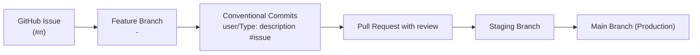
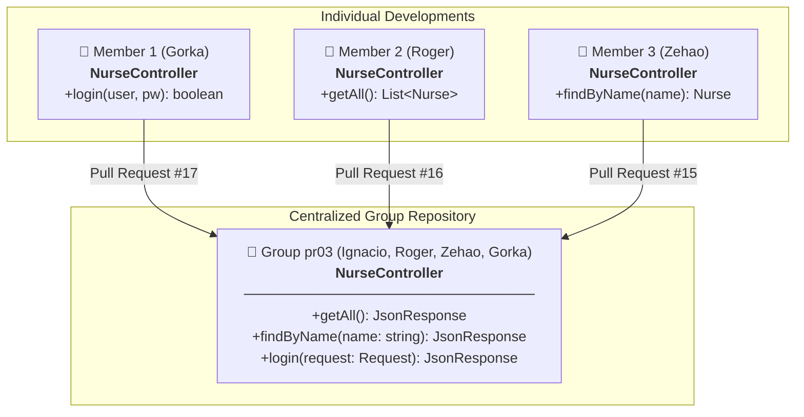
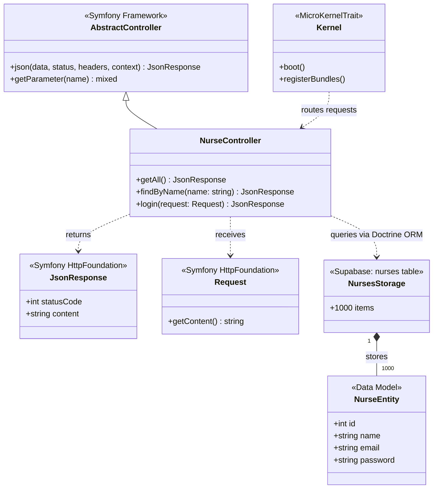
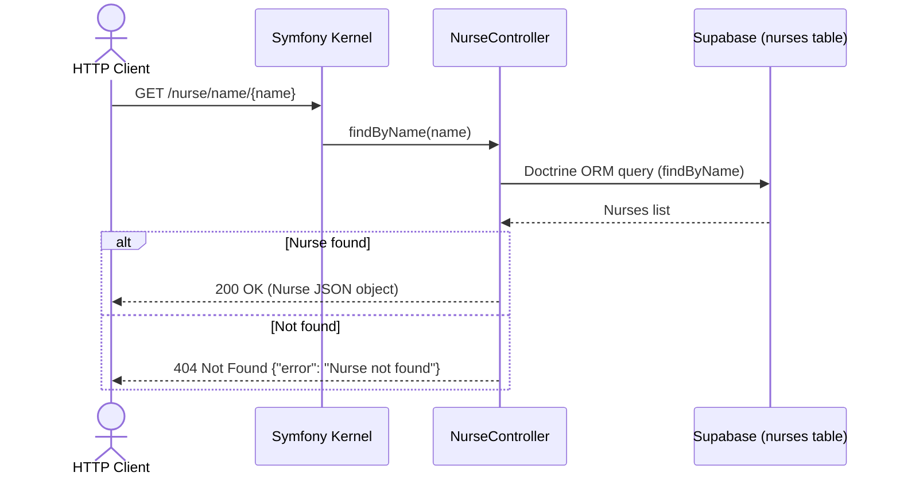
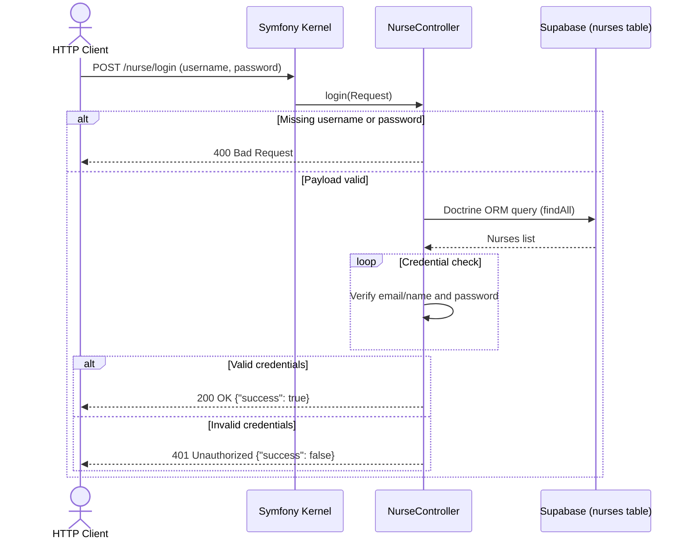
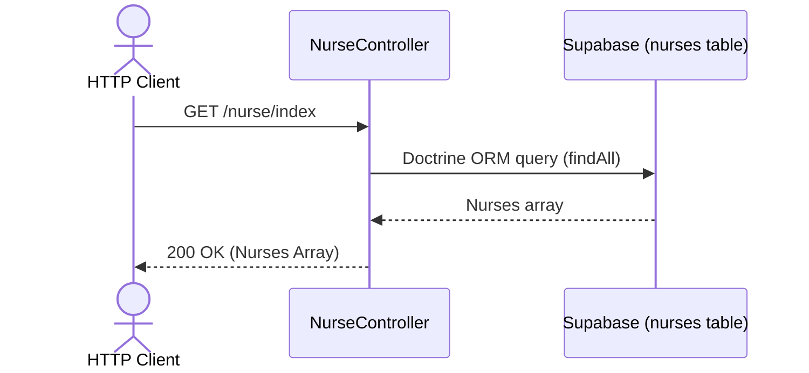
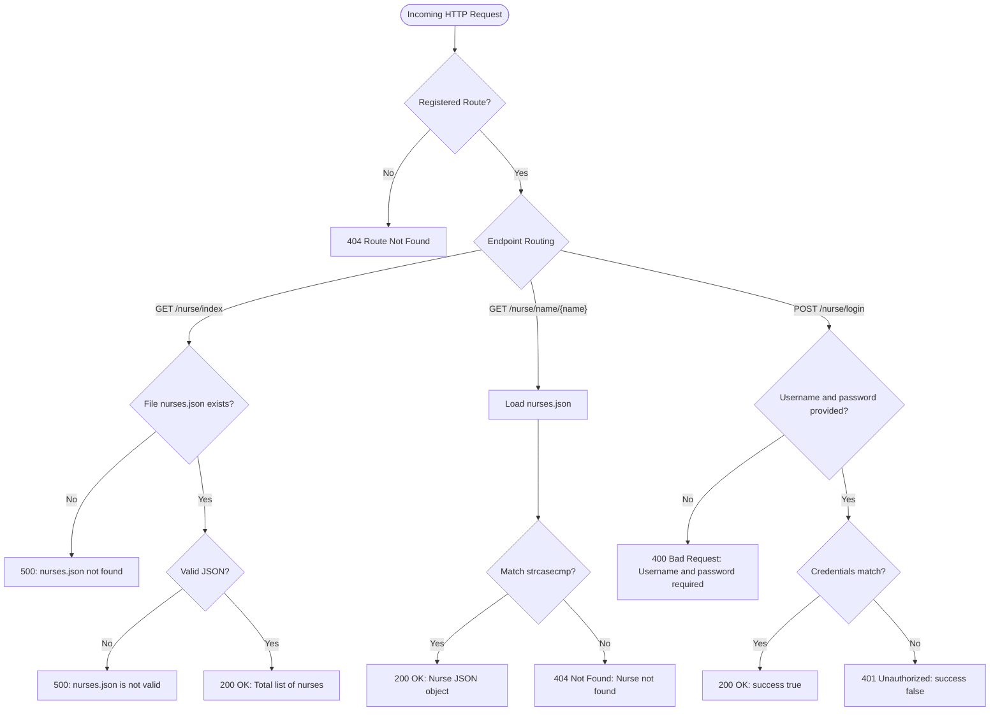

# Nurse Simulator — Comprehensive Project Documentation

> **M0616 - Intermodular Project | DAW 2 (Academic Year 2026/2027)**  
> **Institution:** STUCOM Pelai (Barcelona)  
> **Team:** Group pr03  
> **Authors:** Ignacio Breñas Muñoz, Christopher Roger Tito Farez, Zehao Yin, Gorka Ramirez  
> **Repository:** [https://github.com/Ignaciobrenas/Nurse-Simulator](https://github.com/Ignaciobrenas/Nurse-Simulator)

---

## 1. Executive Summary & Team Roles

**Nurse Simulator** is a RESTful API built with **Symfony 7.4** and **PHP 8.2+** designed to simulate the management of hospital nursing staff.

The project is structured as an academic team endeavor conceived to evolve incrementally across progressive development phases. In this initial phase, the API exposes essential web services for querying, searching, and authenticating nurses, utilizing a file-based storage architecture decoupled from traditional relational database systems.

### Development Team & Roles

| Member | Role | Responsibilities |
|---|---|---|
| **Ignacio Breñas Muñoz** | **Project Manager & Tech Lead** | Overall team organization, feature branch creation for each developer, issue breakdown and assignment in GitHub Projects, Pull Request reviews, and project quality assurance. |
| **Christopher Roger Tito Farez** | **Backend Developer** | Implementation of `GET /nurse/index` endpoint and Postman run evidence. |
| **Zehao Yin** | **Backend Developer** | Implementation of `GET /nurse/name/{name}` endpoint and 1,000 nurses mock dataset expansion. |
| **Gorka Ramirez** | **Backend Developer** | Implementation of `POST /nurse/login` credential validation and Postman test evidence. |

---

## 2. Data Architecture & Storage

In the current development phase, the application does not rely on a relational database (such as MySQL or PostgreSQL). Instead, all data is read and parsed from a structured JSON file:

* **File Location:** [`data/nurses.json`](file:///C:/Users/Ignacio/Desktop/Nurse-Simulator/data/nurses.json)
* **Dataset Volume:** Contains 1,000 mock records generated to evaluate the API's behavior and performance under realistic load conditions.

### Nurse Entity Schema

Each row in the `nurses` table on Supabase contains the following fields:

| Field | Data Type | Description |
|---|---|---|
| `id` | `int` | Unique identifier for the nurse |
| `name` | `string` | Full name of the nurse |
| `email` | `string` | Contact email address |
| `password` | `string` | Access credential |

> [!WARNING]
> Passwords are currently stored in **plain text** solely for educational and local prototyping purposes. Future phases will introduce cryptographic hashing via `PasswordHasherInterface` and secure token/session-based authentication.

---

## 3. Methodology & Git Workflow

The team adopts an agile development methodology supported by **GitHub** collaboration tools:



### Core Workflow Guidelines:
1. **GitHub Projects:** Tasks are tracked on a Kanban board across three columns: `Todo`, `In progress`, and `Done`.
2. **Issues & Branching:** Every feature or bugfix is linked to an *Issue*. Developers create a dedicated branch formatted as:  
   `<issue_number>-<description>`  
   *(Example: `2-implement-read-all-nurses-from-file`)*.
3. **Commit Convention:**  
   `user/Type: description #issue`  
   *(Example: `roger/Feat: implement read all nurses from file #2`)*.
4. **Pull Requests & Code Review:** All branches must go through a peer-reviewed *Pull Request* targeting `staging` before final integration into `main`.

---

## 4. Completed Work & Development Phases

### 4.1. Basic Framework Setup
* Initialized the core project structure on **Symfony 7.4**.
* Configured Composer dependencies via [`composer.json`](file:///C:/Users/Ignacio/Desktop/Nurse-Simulator/composer.json), application lifecycle in [`src/Kernel.php`](file:///C:/Users/Ignacio/Desktop/Nurse-Simulator/src/Kernel.php), and routes in [`config/routes.yaml`](file:///C:/Users/Ignacio/Desktop/Nurse-Simulator/config/routes.yaml).
* Provided a [`.env.example`](file:///C:/Users/Ignacio/Desktop/Nurse-Simulator/.env.example) environment template to protect secrets and facilitate local environment setup.

### 4.2. Read All Nurses From File
* **Branch:** `2-implement-read-all-nurses-from-file`
* **Implementation:** `GET /nurse/index` endpoint inside [`NurseController`](file:///C:/Users/Ignacio/Desktop/Nurse-Simulator/src/Controller/NurseController.php).
* **Logic:**
  1. Verifies the physical existence of [`data/nurses.json`](file:///C:/Users/Ignacio/Desktop/Nurse-Simulator/data/nurses.json). If missing, returns HTTP 500 (`nurses.json not found`).
  2. Reads and parses JSON contents. If invalid or corrupt, returns HTTP 500 (`nurses.json is not valid`).
  3. Returns the complete array of nurse records with HTTP 200 JSON response upon success.

### 4.3. Implement Nurse Login From File
* **Branch:** `3-implement-nurse-login-from-file`
* **Implementation:** `POST /nurse/login` endpoint inside [`NurseController`](file:///C:/Users/Ignacio/Desktop/Nurse-Simulator/src/Controller/NurseController.php).
* **Logic:**
  1. Accepts a JSON request body containing `username` and `password`.
  2. Validates that both fields are supplied. If either is missing, responds with HTTP 400 (`Username and password are required`).
  3. Compares credentials against records in [`data/nurses.json`](file:///C:/Users/Ignacio/Desktop/Nurse-Simulator/data/nurses.json):
     * The `username` field flexibly matches either the **`email`** or the **`name`** field using case-insensitive comparison (`strcasecmp`).
  4. Returns HTTP 200 with `{"success": true}` on matching credentials.
  5. Returns HTTP 401 Unauthorized with `{"success": false}` if credentials do not match.

### 4.4. Find Nurse By Name From File
* **Branch:** `4-implement-find-nurse-by-name-from-file`
* **Implementation:** `GET /nurse/name/{name}` endpoint inside [`NurseController`](file:///C:/Users/Ignacio/Desktop/Nurse-Simulator/src/Controller/NurseController.php).
* **Logic:**
  1. Extracts `{name}` from the route parameters.
  2. Queries the `nurses` table on Supabase via Doctrine ORM, filtering by name (case-insensitive).
  3. Returns HTTP 200 with the matching nurse object if found.
  4. Returns HTTP 404 with `{"error": "Nurse not found"}` if no matching record exists.
  5. Mock data was migrated from the JSON file into the Supabase database.

---

## 5. API Specification & Endpoints

### Endpoint Summary

| Method | Endpoint | Parameters | Expected Responses |
|---|---|---|---|
| `GET` | `/nurse/index` | None | `200 OK`: Array of all nurses<br>`500 Internal Server Error`: Missing file or corrupt JSON |
| `GET` | `/nurse/name/{name}` | Path param: `name` (string) | `200 OK`: Nurse object<br>`404 Not Found`: `{ "error": "Nurse not found" }` |
| `POST` | `/nurse/login` | JSON Body: `username`, `password` | `200 OK`: `{ "success": true }`<br>`400 Bad Request`: Missing credentials<br>`401 Unauthorized`: `{ "success": false }` |

### Request and Response Examples

#### 1. Retrieve all nurses
```bash
curl -X GET http://localhost:8000/nurse/index
```
**Response (HTTP 200):**
```json
[
  {
    "id": 1,
    "name": "Ana",
    "email": "ana@hospital.com",
    "password": "ana123"
  },
  {
    "id": 2,
    "name": "Carlos",
    "email": "carlos@hospital.com",
    "password": "carlos123"
  }
]
```

#### 2. Search nurse by name
```bash
curl -X GET http://localhost:8000/nurse/name/Ana
```
**Response (HTTP 200):**
```json
{
  "id": 1,
  "name": "Ana",
  "email": "ana@hospital.com",
  "password": "ana123"
}
```
**Error Response (HTTP 404):**
```json
{
  "error": "Nurse not found"
}
```

#### 3. Nurse login
```bash
curl -X POST http://localhost:8000/nurse/login \
  -H "Content-Type: application/json" \
  -d '{"username": "ana@hospital.com", "password": "ana123"}'
```
**Success Response (HTTP 200):**
```json
{
  "success": true
}
```
**Unauthorized Response (HTTP 401):**
```json
{
  "success": false
}
```
**Missing Fields Response (HTTP 400):**
```json
{
  "success": false,
  "message": "Username and password are required"
}
```

---

## 6. Architecture, UML Schemas & Flowcharts

### 6.1. Modular Integration Schema (Individual Development to Group Repository)

Based on the official intermodular assignment guidelines (`pr03_Introduccio_back_end`), each developer implemented their endpoint method individually before coordinated merging into the centralized group repository:



### 6.2. UML Class Diagram

Representation of the application classes and relationships built on Symfony 7.4:



### 6.3. Sequence Diagram: Search Nurse by Name



### 6.4. Sequence Diagram: Nurse Login



### 6.5. Sequence Diagram: Read All Nurses



### 6.6. Application Logic Flowchart



---

## 7. Testing & Postman Collection

A dedicated **Postman** collection with verified request templates and test evidence is available in:
* [`docs/postman/nurse-api.postman_collection.json`](file:///C:/Users/Ignacio/Desktop/Nurse-Simulator/docs/postman/nurse-api.postman_collection.json)

The collection includes organized subfolders mirroring test executions:
* [`docs/postman/readAll`](file:///C:/Users/Ignacio/Desktop/Nurse-Simulator/docs/postman/readAll): Tests for `/nurse/index`.
* [`docs/postman/readByName`](file:///C:/Users/Ignacio/Desktop/Nurse-Simulator/docs/postman/readByName): Tests for `/nurse/name/{name}` covering 200 and 404 statuses.
* [`docs/postman/login`](file:///C:/Users/Ignacio/Desktop/Nurse-Simulator/docs/postman/login): Tests for `/nurse/login` covering 200, 400, and 401 statuses.

---

## 8. Project Structure

```
Nurse-Simulator/
├── bin/
│   └── console                     # Symfony CLI tool
├── config/                         # Configuration files (routes, packages, services)
│   ├── packages/
│   ├── routes.yaml
│   └── services.yaml
├── data/
│   └── nurses.json                 # Mock dataset (1,000 nurses)
├── docs/                           # Documentation directory
│   ├── general/
│   │   ├── DOCUMENTACION_ES.md     # Full Spanish documentation
│   │   ├── DOCUMENTATION_EN.md     # Full English documentation
│   │   ├── Nurse-Simulator.docx    # Project report document
│   │   └── Nurse-Simulator_...pdf  # Official academic report (PDF)
│   └── postman/                    # Postman collection and run evidence
│       ├── login/
│       ├── readAll/
│       ├── readByName/
│       └── nurse-api.postman_collection.json
├── public/
│   └── index.php                   # Web application entry point (Front Controller)
├── src/
│   ├── Controller/
│   │   └── NurseController.php     # Controller handling nurse endpoints
│   └── Kernel.php                  # Symfony application kernel
├── .env.example                    # Environment configuration template
├── composer.json                   # PHP dependencies and autoload definitions
├── README.md                       # Quick start guide
└── LICENSE                         # Project license
```

---

## 9. Installation & Local Execution

### Prerequisites
* **PHP** >= 8.2 (with `mbstring`, `json`, `ctype`, `pdo_pgsql`, etc.)
* **Composer** >= 2.0
* **A [Supabase](https://supabase.com/) account and project** with the 
urses table set up
* *(Optional)* **Symfony CLI**

### Setup Instructions

1. **Clone the repository:**
   ```bash
   git clone https://github.com/Ignaciobrenas/Nurse-Simulator.git
   cd Nurse-Simulator
   ```

2. **Install dependencies:**
   ```bash
   composer install
   ```

3. **Configure environment:**
   ```bash
   cp .env.example .env
   ```

4. **Launch the development server:**
   * Using Symfony CLI:
     ```bash
     symfony server:start
     ```
   * Or with PHP's built-in server:
     ```bash
     php -S localhost:8000 -t public
     ```

5. **Inspect registered routes:**
   ```bash
   php bin/console debug:router
   ```

---

## 10. Roadmap & Upcoming Milestones

The following architectural enhancements are scheduled for upcoming phases:

1. **Persistence & Repository Layer:** Decouple file reading from the controller into a dedicated `NurseRepository` service.
2. **Entities & DTOs:** Introduce strongly-typed models with validation constraints (Symfony Validator).
3. **Security & Hashing:** Implement secure password hashing via `PasswordHasherInterface` and modern authentication (JWT / sessions).
4. **Relational Database:** ✅ Completed — the API now uses **Supabase (PostgreSQL)** as a remote database, managed through **Doctrine ORM** and migrations.
5. **Automated Testing:** Integrate unit and end-to-end integration test suites with PHPUnit and Symfony's `WebTestCase`.
